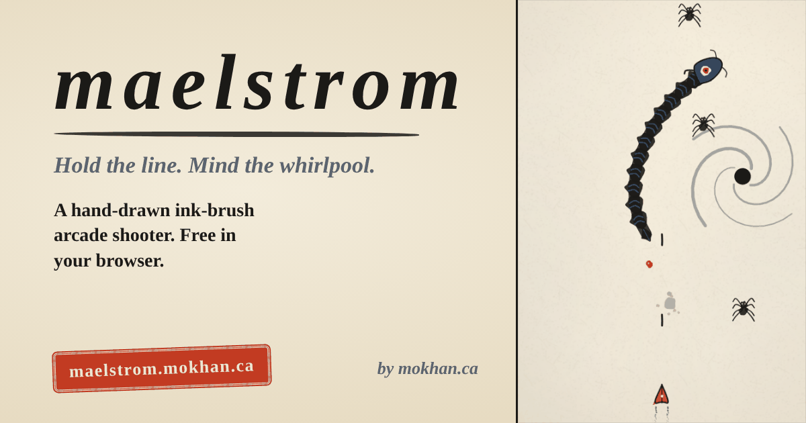

# Maelstrom

A hand-drawn ink-brush arcade shooter. Play free at https://maelstrom.mokhan.ca



Drag or use arrows/WASD to fly. Firing is automatic on touch, Space on keyboard. P pauses, M mutes.

```bash
npm install
npm run dev
npm test
```

Pushes to `main` deploy to Cloudflare once tests pass.

Maelstrom started in 2014 as a hand-written canvas game by mo khan and Anthony
Roe; that version is archived at
[xlgmokha/maelstrom](https://github.com/xlgmokha/maelstrom). It was rebuilt in
2026 and is maintained by [2809074 Alberta Ltd.](https://www.mokhan.ca)
